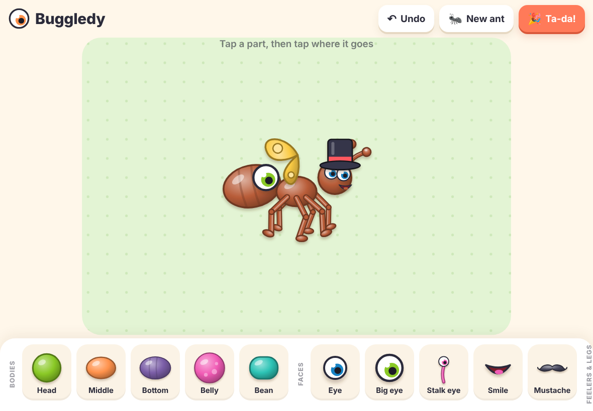

# Buggledy 🐜

**Build a silly bug together.**

Buggledy is a touchscreen game where the whole family builds one shared bug. You start with a simple ant, then add, move, recolor, and stack parts until it's as ridiculous as you like. There's no winner. The finished silly bug is the reward.

## Play

Open `index.html` in any modern browser. It's built for tablets and also works with a mouse.

- **Add a part:** tap a part in the tray, then tap where it goes. You can also drag it straight onto the bug.
- **Change a part:** tap it to recolor, flip, copy, layer, or remove it.
- **Rotate and resize:** drag the orange knob, or pinch with two fingers.
- **Put a part away:** drag it back into the tray.
- **Ta-da!** Celebrate the finished bug. It wiggles, and it gets a random silly name.

## Design choices

- **One shared bug.** Everyone works together, so there's no competition.
- **Tap-then-tap placement.** Young kids find this easier than dragging, and dragging still works too.
- **Flat, uncluttered interface** with large touch targets.
- **Toy-like illustrated parts.** All 24 parts are drawn in SVG code, with no image files.
- **One self-contained HTML file** with no build step or dependencies.

## Credits

Created by **[Wilder407](https://github.com/Wilder407)**. Built with AI coding assistance (Claude).
